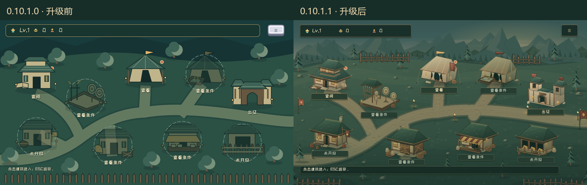

# 主城美术升级 · 0.10.1.1

GDD v0.37.107 / CITY v0.2 / schema13。Godot 4.7.1原生渲染，暮色墨绿暖金为默认。

[新版新档](dusk_new.png) / [解锁主城](city_unlocked.png) / [鼠标悬停](gate_hover.png) / [键盘焦点](gate_focus.png) / [首用说明](first_visit.png) / [菜单按住态](menu_pressed.png) / [系统菜单](system_menu.png) / [施工条件](construction.png) / [1600×900](wide_city.png)。

[出征选关](map.png) / [中军帐](command.png) / [养成](develop.png) / [市集](shop.png) / [百科](encyclopedia.png) / [设置](settings.png) / [昼色对照](day_new.png)。16张原图，before_after只等比缩放拼接。

[SVG概念](../city_0.10.1.1/README.md) / [验收报告](../../reviews/CITY_ART_2026-11-17.md)。原0.10.1.0原生图与概念保留。
