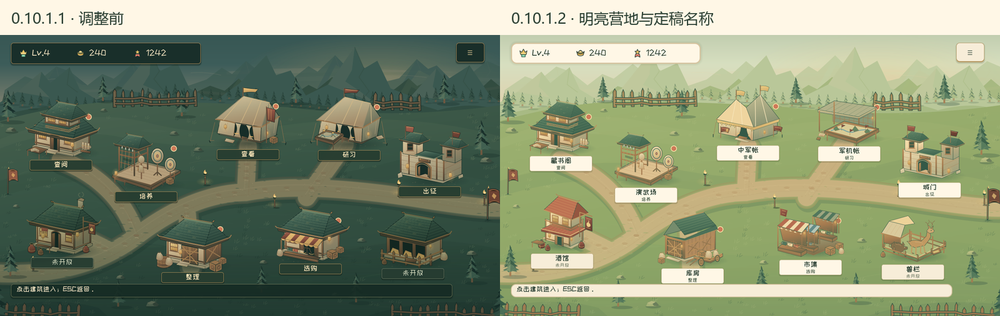
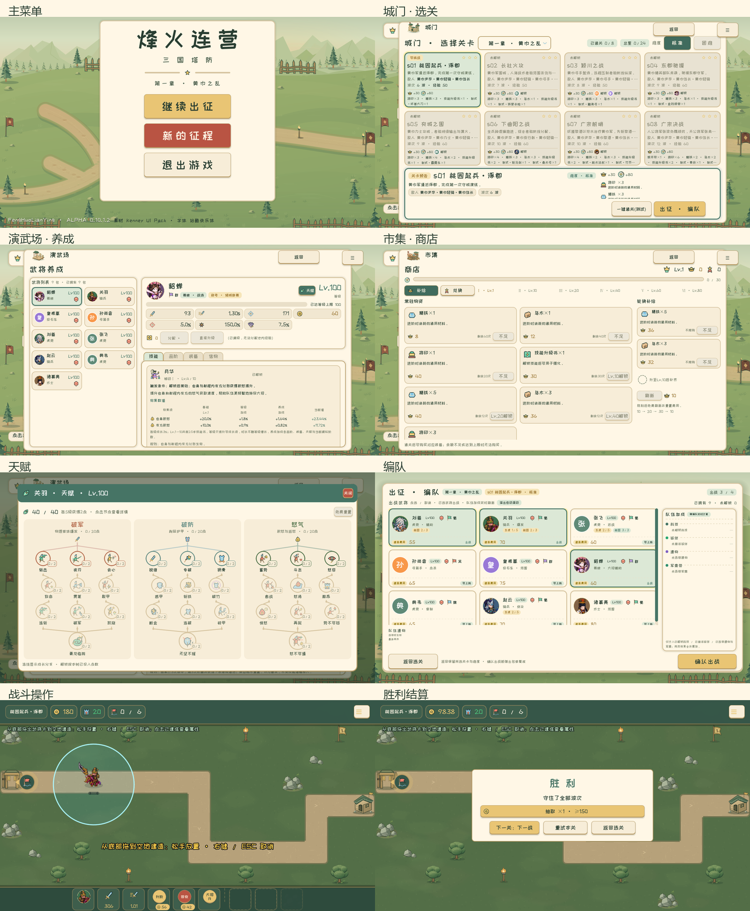

# 明亮营地与全界面协调 · 0.10.1.2

GDD v0.37.108 / CITY v0.3 / UI_LAYOUT v0.21.2 / ICONS v1.9 / schema13。Godot 4.7.1原生窗口捕获，原图没有改色。

19张主城/入口原图，46张全界面原图；概览只等比缩放拼接。旧0.10.1.1保留独立目录。

- [city_unlocked](city_unlocked.png)
- [command](command.png)
- [construction](construction.png)
- [day_new](day_new.png)
- [develop](develop.png)
- [dusk_new](dusk_new.png)
- [encyclopedia](encyclopedia.png)
- [first_visit](first_visit.png)
- [gate_focus](gate_focus.png)
- [gate_hover](gate_hover.png)
- [inventory](inventory.png)
- [map](map.png)
- [menu_pressed](menu_pressed.png)
- [settings](settings.png)
- [shop](shop.png)
- [supply](supply.png)
- [system_menu](system_menu.png)
- [tech](tech.png)
- [wide_city](wide_city.png)

## 功能与交互

- [battle_buttons](interfaces/battle_buttons.png)
- [battle_dialogue](interfaces/battle_dialogue.png)
- [battle_menu_buttons](interfaces/battle_menu_buttons.png)
- [battle_supply_buttons](interfaces/battle_supply_buttons.png)
- [battle_tower_buttons](interfaces/battle_tower_buttons.png)
- [battle_tower_max_buttons](interfaces/battle_tower_max_buttons.png)
- [buttons_develop](interfaces/buttons_develop.png)
- [buttons_encyclopedia](interfaces/buttons_encyclopedia.png)
- [buttons_inventory](interfaces/buttons_inventory.png)
- [buttons_map](interfaces/buttons_map.png)
- [buttons_settings](interfaces/buttons_settings.png)
- [buttons_shop](interfaces/buttons_shop.png)
- [buttons_supply](interfaces/buttons_supply.png)
- [buttons_tech](interfaces/buttons_tech.png)
- [confirmation_buttons](interfaces/confirmation_buttons.png)
- [defeat_buttons](interfaces/defeat_buttons.png)
- [diao_chan_skills](interfaces/diao_chan_skills.png)
- [diao_chan_ultimate](interfaces/diao_chan_ultimate.png)
- [encyclopedia_skill_numbers](interfaces/encyclopedia_skill_numbers.png)
- [guan_yu_skills](interfaces/guan_yu_skills.png)
- [guan_yu_ultimate](interfaces/guan_yu_ultimate.png)
- [huang_fu_song_skills](interfaces/huang_fu_song_skills.png)
- [huang_fu_song_ultimate](interfaces/huang_fu_song_ultimate.png)
- [huang_zhong_skills](interfaces/huang_zhong_skills.png)
- [huang_zhong_ultimate](interfaces/huang_zhong_ultimate.png)
- [liu_bei_skills](interfaces/liu_bei_skills.png)
- [liu_bei_ultimate](interfaces/liu_bei_ultimate.png)
- [main_menu_buttons](interfaces/main_menu_buttons.png)
- [main_menu_confirm](interfaces/main_menu_confirm.png)
- [shop_available_buttons](interfaces/shop_available_buttons.png)
- [shop_exchange_buttons](interfaces/shop_exchange_buttons.png)
- [squad_buttons](interfaces/squad_buttons.png)
- [squad_confirm_buttons](interfaces/squad_confirm_buttons.png)
- [talent_buttons](interfaces/talent_buttons.png)
- [talent_detail_buttons](interfaces/talent_detail_buttons.png)
- [victory_buttons](interfaces/victory_buttons.png)
- [victory_claimed_buttons](interfaces/victory_claimed_buttons.png)
- [zhang_fei_skills](interfaces/zhang_fei_skills.png)
- [zhang_fei_ultimate](interfaces/zhang_fei_ultimate.png)
- [zhao_yun_skills](interfaces/zhao_yun_skills.png)
- [zhao_yun_ultimate](interfaces/zhao_yun_ultimate.png)
- [zhou_wei_skills](interfaces/zhou_wei_skills.png)
- [zhou_wei_ultimate](interfaces/zhou_wei_ultimate.png)
- [zhou_wei_ultimate_top](interfaces/zhou_wei_ultimate_top.png)
- [zhuge_liang_skills](interfaces/zhuge_liang_skills.png)
- [zhuge_liang_ultimate](interfaces/zhuge_liang_ultimate.png)

[新图标与实际尺寸](../game_icon_0.10.1.2/README.md) / [验收报告](../../reviews/CAMP_UI_2026-11-17.md)。
