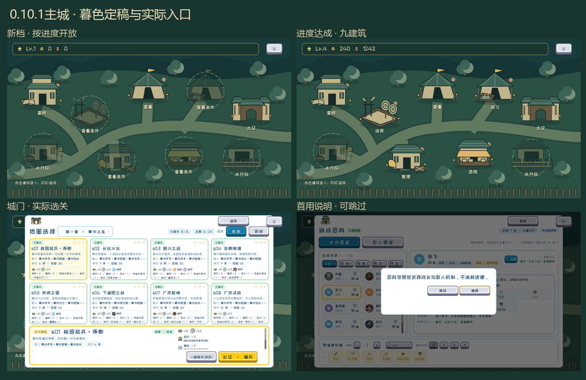

# 主城实机 · 0.10.1.0

用户选择暮色墨绿暖金版。GDD v0.37.106 / schema13，Godot 4.7.1原生窗口。

[新档主城](dusk_new.png) / [解锁状态](city_unlocked.png) / [城门选关](map.png) / [中军帐](command.png) / [演武场](develop.png) / [市集](shop.png) / [藏书阁](encyclopedia.png) / [首用说明](first_visit.png) / [系统菜单](system_menu.png) / [设置](settings.png) / [施工条件](construction.png) / [1600×900](wide_city.png)

[昼色备选](day_new.png) / [两版概念稿](../city_0.10.1/README.md) / [验收报告](../../reviews/CITY_2026-11-09.md)。原图13张，overview仅等比缩放拼接。

新档图使用真实初始角色与零余额。解锁图与功能页使用隔离的视觉夹具（八关通关记录、主公经验140、元宝240、军功1242），只验证界面与路由；两种真实新档连续通关另由ProgressionRunner验证，不把视觉夹具作为成长证明。
