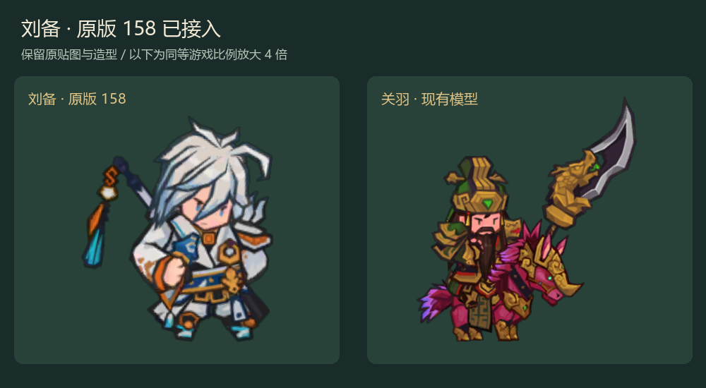
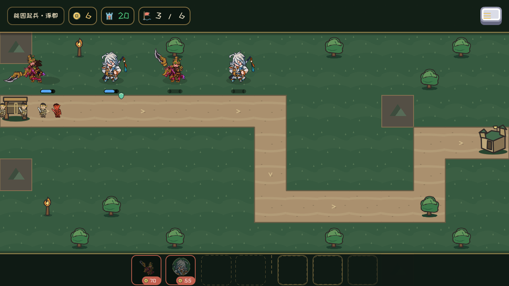

# 0.9.8.1 原版158刘备

用户最终指定原版158（Hero_LiBai_A）。保留原脸、白发、服饰、武器、配饰与动作，战场与头像同源。GDD v0.37.97；A/B历史试作不再采用。

[养成头像](new_save_develop.png) / [拖放](drag_liu_bei.png) / [结算](new_save_victory.png) / [74张原生姿态与测量](frames/frames.json) / [验收报告](../../reviews/LIU_BEI_ORIGINAL158_2026-11-05.md)。

游戏图原生1280×720；对照人物放大4倍。刘备待机轮廓69×80、关羽80×87。源普攻/暴击/施法动作通过播放时标适配战斗，技能数值保持。Windows独立启动和482项包检查通过。
