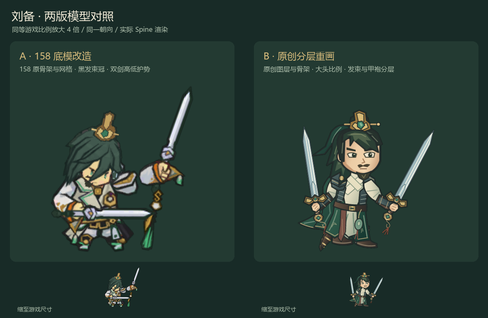
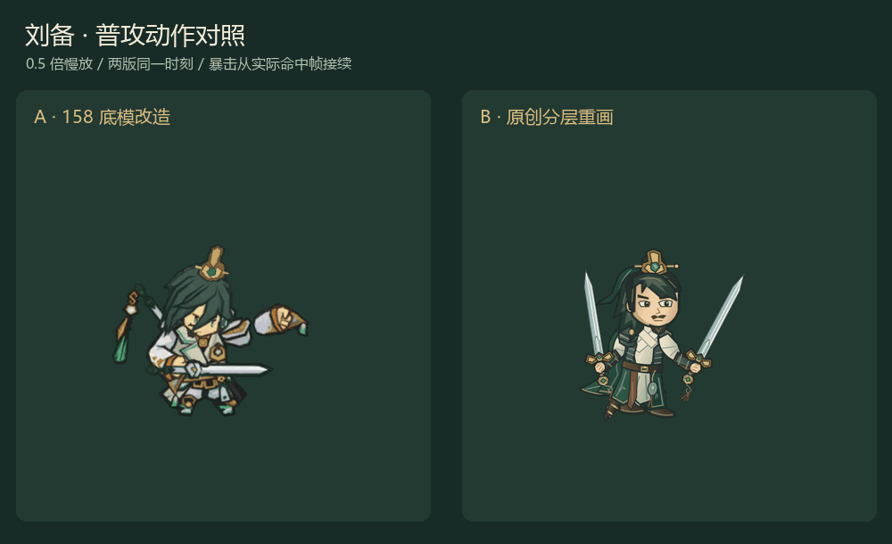

# 刘备 A/B 历史试作（未采用）

2026-11-05，两版已完成可播放对照后，用户明确改为直接使用原版158。本目录保留试作记录；最终图见[原版158](../runtime_0.9.8.1/README.md)。

[关键动作帧](keyframes.png) / [捕获时刻清单](capture_frames.json)。共512帧在build/liu_variants_0.9.8.1捕获；本目录保存合成结果与时刻清单，原帧可用tools/capture_liu_variants.tscn重建。底部小图为缩至游戏尺寸，不是独立1倍截图。

交互入口：tools/LiuVariantsPreview.tscn；两版各17项初次战斗检查通过。A为158衍生，B为原创图层和骨架；均排除发行包。
