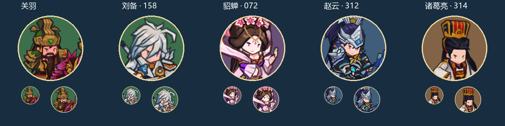
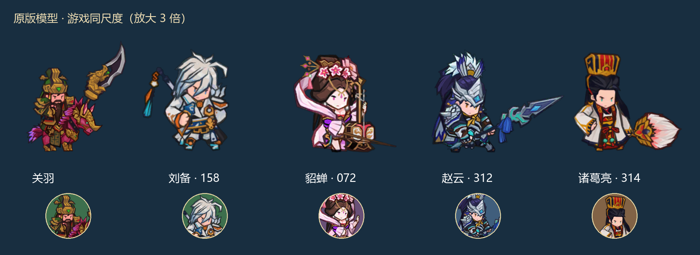
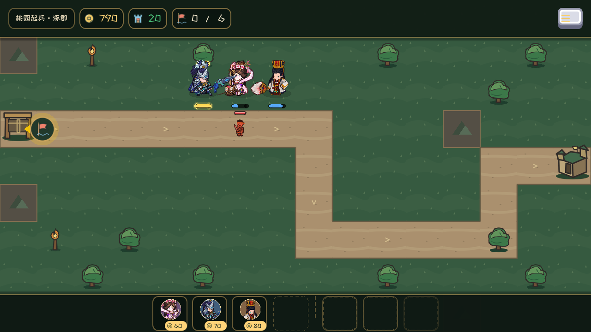

# 0.9.8.2 三将原模型与统一头像

貂蝉072、赵云312、诸葛亮314直接采用原素材，关羽/刘备作为同尺度参照；原动作通过运行时播放衔接，赵云整体位移限制在建造格附近。五将头像采用同源面部与圆形边框。

[赵云拖放虚影与攻击范围](drag_zhao_yun.png) / [关羽养成头像](develop_guan_yu.png) / [貂蝉百科](encyclopedia_diao_chan.png) / [编队](squad_heroes.png)。16张游戏截图均为1280×720。

[貂蝉动作采样](diao_chan_poses.jpg) / [赵云动作采样](zhao_yun_poses.jpg) / [诸葛亮动作采样](zhuge_liang_poses.jpg) / [116张原生关键帧与测量](frames/frames.json) / [676帧完整测量](../../reviews/hero_models_2026-11-09/animation_frames.json) / [验收报告](../../reviews/HERO_MODELS_2026-11-09.md)。

动作帧采集于2026-11-06，最终界面/拖放/战斗于2026-11-09重捕获。完整676张采样PNG保留在build/hero_models_skin_0.9.8.2，可按报告命令重建；仓库保存关键帧、动作采样图与全部测量。貂蝉头像专用捕获隐藏武器槽位，战斗中武器完整；赵云面部居中、关羽统一圆底金边。

视觉夹具会解锁三将、提供1000金币并使用静止高生命目标及75%暴击，便于观察普通/暴击/辅助/大招；这些图片不用于证明关卡或养成平衡。程序0.9.8.2 / GDD v0.37.103。
