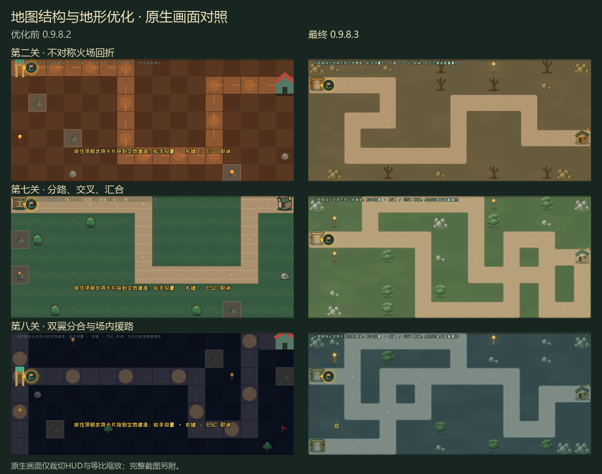

# 首章地图结构与地形优化 · 0.9.8.3

GDD v0.37.105。八关共13条完整行走路线，支持交叉、实际分流/汇流与Boss援路；首章仍为单基地。截图来自Godot 4.7.1原生运行。

[八关实机总览](map_overview.png) / [彩色路线示意](route_overview.png) / [验收报告](../../reviews/MAP_POLISH_2026-11-09.md)

| 图组 | 内容 |
|---|---|
| [第一关](after/s01_start.png) / [第二关](after/s02_start.png) / [第三关](after/s03_start.png) / [第四关](after/s04_start.png) | 入门双弯、不对称回折、十字回穿、双翼分流 |
| [第五关](after/s05_start.png) / [第六关](after/s06_start.png) / [第七关](after/s07_start.png) / [第八关](after/s08_start.png) | 双环汇流、逆向纵深、交叉双路、双翼合围与援路 |
| [拖放](after/s01_drag.png) / [首关战斗](after/s01_battle.png) | 网格、禁建边界、同源虚影与真实战斗 |
| [实际分流](after/s04_split.png) / [交叉通过](after/s07_crossing.png) / [Boss援军](after/s08_reinforcements.png) | 怪物实际沿各自路线行进 |
| [缺图回退](after/s08_missing_art.png) / [多路线编辑器](after/editor_s08.png) / [无网格底图](after/editor_s08_base.png) | 回退、路线切换入口与纯底图导出 |

最终[after](after/capture.json)共16张；[before](before/capture.json)保留0.9.8.2的10张旧图；[art_only](art_only/capture.json)保留本轮重排路线前的13张仅美术阶段图。最终画面等待入场短提示消失；旧版原图保留该提示。

使用隔离存档、正常难度、初始Lv1关羽/刘备与真实关卡金币。分流/交叉图为未布防的首波观察；援军图跳至真实第11波，不补发前10波奖励。它们用于路线和视觉验收，连续通关另见报告。原图不改色；总览仅等比缩放，彩色路线图为独立示意。
