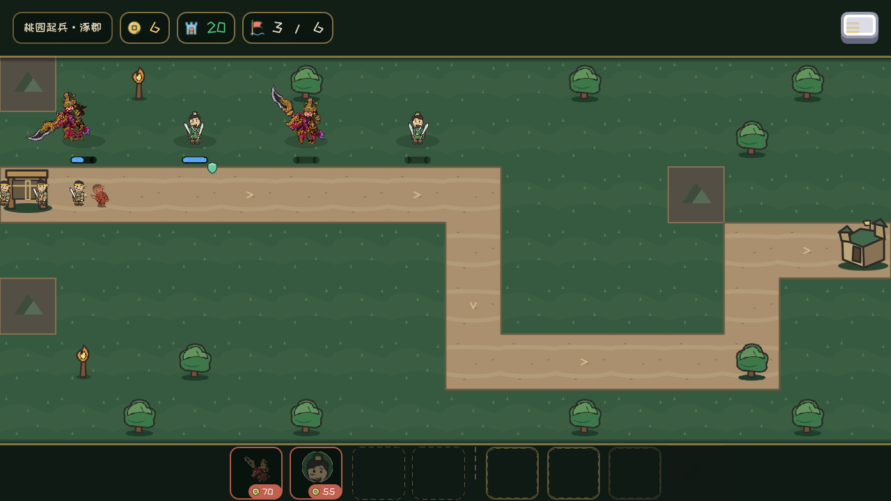
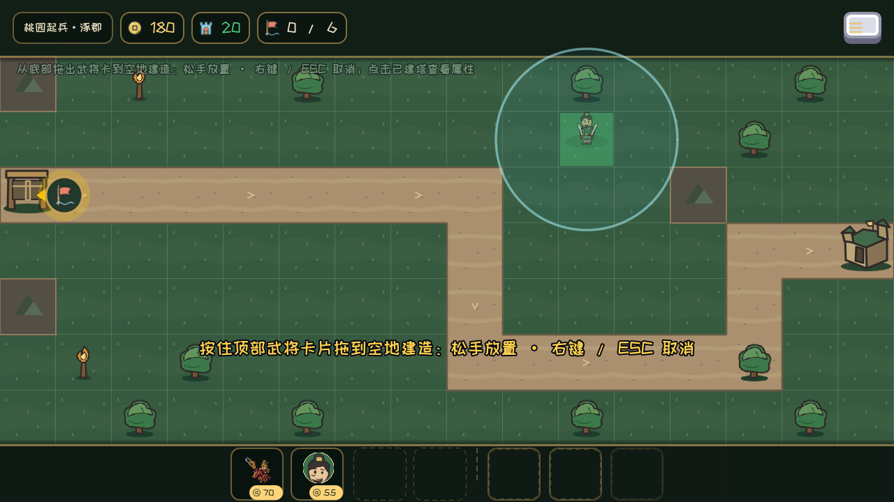

# 0.9.8.0 原生战场样板

8张1280×720原生界面；真实初始Lv1白阶部署、六波胜利、养成与购买重载25项通过。6身份×左右×6动画=72透明帧、4血条/眩晕帧和刘备Idle头像源帧（frames/）；原生帧工具226项通过。缩放图集actors_sheet仅便于浏览，尺寸以frames.json的原生轮廓为准。

程序0.9.8.0 / GDD v0.37.91 / BATTLE_VISUALS v0.3。capture_hashes.json登记86张PNG，历史目录保持。

复现：Godot运行tests/BattleVisualPreviewRunner.tscn，可通过--capture-dir指定新目录；工具运行tools/capture_battle_visuals.tscn生成独立骨架帧。驱动用隔离存档/设置，无调试收益、清怪或通关。发布包实际DLL/PE检查与报告见docs/reviews/BATTLE_VISUALS_IMPLEMENTATION_2026-11-05.md。
